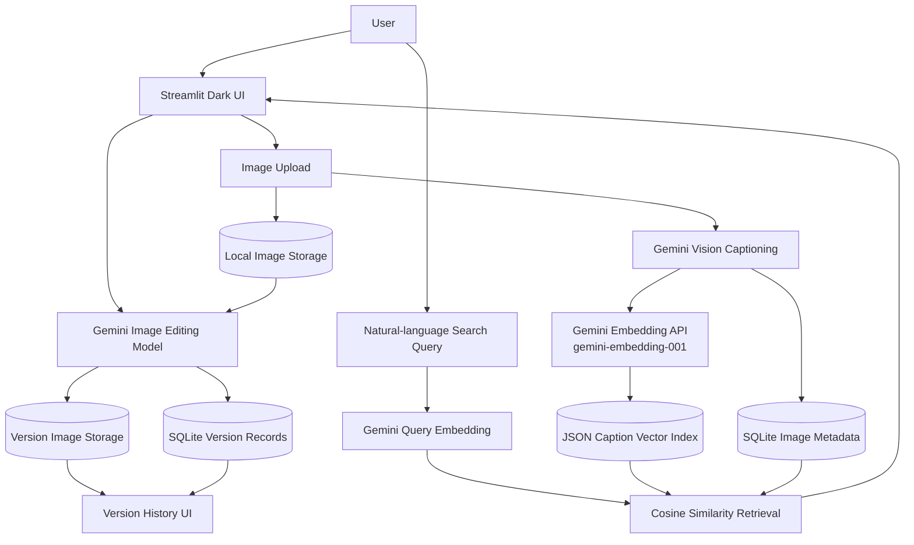
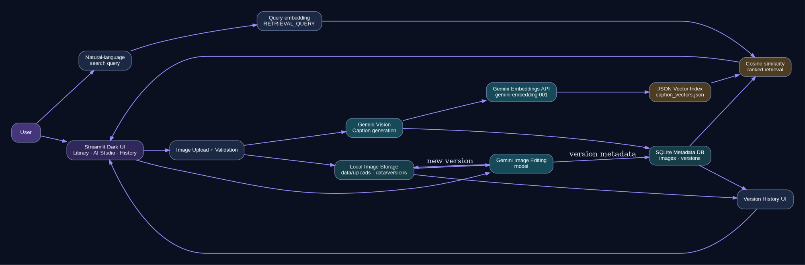

# PixelAI — AI-Powered Image Editing Platform

A single-user portfolio MVP built with **Python, Streamlit, Gemini APIs, SQLite and local image storage**.

## Features
- Upload JPG, PNG, JPEG and WebP images.
- Gemini Vision generates searchable factual captions.
- Search library images semantically using Gemini caption embeddings and cosine similarity.
- Edit an image using natural-language instructions.
- Preset prompts: enhance, change background, remove background, change colours, remove object.
- Keep original images unchanged and store each edit as a separate version.
- Browse and download previous versions.

## Architecture
```text
Streamlit UI
  ├─ My Library: upload -> local storage -> Gemini caption -> SQLite
  ├─ Search: natural-language-style search over captions
  ├─ AI Studio: original image + instruction -> Gemini image model -> edited file
  ├─ Semantic Search: Gemini query embedding -> JSON vector index -> cosine similarity ranking
  └─ Version History: SQLite version records + local image files

Caption Embedding Index
  ├─ Gemini embedding model: gemini-embedding-001
  ├─ Document vectors: generated from each image caption at upload time
  ├─ Query vectors: generated for each natural-language search
  ├─ Retrieval: cosine similarity, highest score first
  └─ Persistence: data/caption_vectors.json (created automatically)
```

## Full System Architecture



## Setup (Windows PowerShell)
1. Install Python 3.10 or newer.
2. Create environment:
   ```powershell
   py -3.11 -m venv .venv
   .venv\Scripts\Activate.ps1
   ```
3. Install:
   ```powershell
   pip install -r requirements.txt
   ```
4. Copy `.env.example` to `.env` and set your Gemini API key:
   ```env
   GEMINI_API_KEY=your_real_key
   GEMINI_VISION_MODEL=gemini-2.5-flash
   GEMINI_IMAGE_MODEL=gemini-3.1-flash-image
   ```
5. Run:
   ```powershell
   streamlit run app.py
   ```

The embedding model can be changed with `GEMINI_EMBEDDING_MODEL`. The default is `gemini-embedding-001`.

## Demo flow
1. My Library -> upload a photo -> Add to library.
2. Wait for Gemini to caption it.
3. Search e.g. `beach`, `dog`, `red car`.
4. AI Studio -> select image -> type `Replace the background with a calm mountain landscape, keeping the person unchanged.` -> Generate edit.
5. Version History -> show original and edit versions.

## API choice
Gemini Vision is used for image understanding/captioning. A Gemini image-generation/editing model is used for the actual image-to-image edit because a text-only vision model cannot return a modified image. Model availability depends on API key, region, quota and account access. Change the model IDs in `.env` if needed.

## Prompt design
Caption prompt: describe visible objects, setting and colours in factual language; do not infer identity or unsupported details.
Edit prompt: include the original image and user instruction, and ask the model to preserve unrelated content.

## Data model
`images`: filename, original file path, caption, MIME type and creation time.
`versions`: parent image ID, sequential version number, edited file path, user prompt and timestamp.

## Limitations and future work
- This MVP is local and single-user; deploy with authentication and cloud storage for multiple users.
- The current JSON vector index is designed for a small single-user project. For larger collections, replace it with FAISS or Chroma and add index migration/rebuild tooling.
- Embeddings are generated from Gemini captions, not directly from image pixels. Search quality therefore depends on caption quality.
- Add delete/restore controls, image comparison slider, rate limiting, safety checks, async jobs, and per-user storage.
- Generated edits can change details outside the requested region; inspect outputs before commercial use.

## Submission
Submit the ZIP/GitHub link, README, screenshots or a short demo recording, and deployment link if your instructor requires one. Include actual screenshots of your own successful API run, not fabricated sample results.

## Official docs
- Gemini image understanding: https://ai.google.dev/gemini-api/docs/image-understanding
- Gemini image generation/editing: https://ai.google.dev/gemini-api/docs/image-generation
- Streamlit: https://docs.streamlit.io/

### Architecture diagram (PNG)


